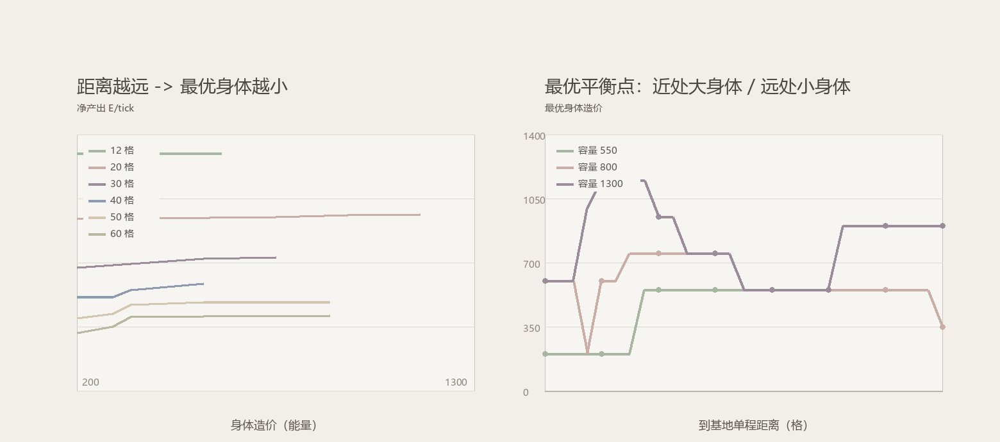
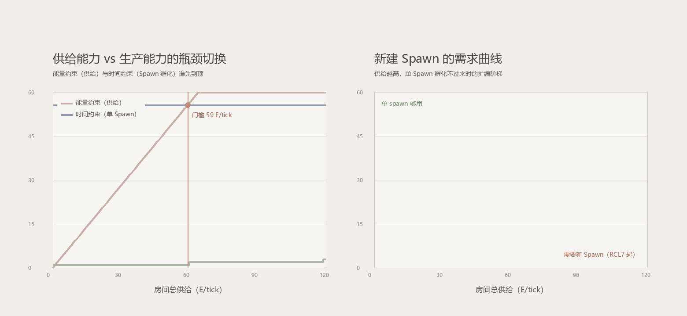

<div align="center">


# Frightening-Wind

**Screeps World 自主殖民 AI —— 从单个 spawn 到多房间经济体的完整自治实现**

[](LICENSE)
[](https://screeps.com)
[](src/)
[](#-测试)
[](#-roadmap)
[](#-贡献)

</div>

---

## 这是什么

Frightening-Wind 是一个为 [Screeps World](https://screeps.com) 编写的**全自治**殖民地 AI。它不依赖任何第三方机器人框架，从零实现了完整的生产链调度、物流网络、边防体系与跨房间扩张，并且把**所有决策依据**沉淀为可观测的遥测数据。

设计目标只有一个：**不顾一切地发育与增长**，同时保证经济不崩、领地不失。

```
矿源 → 静态矿工(独占站位) → 源侧容器 → 搬运工 → 控制器容器/storage → 升级者 → RCL
                                    ↓                                  ↓
                                 建造者 → 扩展/塔/容器            控制器进度 → GCL
                                    ↓
                              边防：巡逻兵 · 士兵 · 塔 · rampart · 侦察兵
```

---

## ✨ 特性

### 经济与物流
- **独占站位采矿**：每个矿工分配专属站位格，同矿源矿工互不抢位，彻底消除排队空转
- **地形感知定编**：按矿源周围可站格数（`min(可站位数, 2)`）决定编制，而非固定人数
- **两级远程运输**：远程矿工就地倾倒容器 + 接驳工批量回运，把 70 格往返拆成"站定 + 短途"
- **距离感知限价**：远程兵种自动降档到能效最优点（模型见 [`analysis/`](analysis/)）
- **工作状态机**：`working` 状态贯穿所有角色，杜绝"采集↔交付"抖动

### 防御与军事
- **威胁分级**：按敌人**能力**（攻击型/拆家型/无害）决定响应，不再因无害单位全区停摆
- **扇区制巡逻**：巡逻兵与士兵共用扇区编号，相邻房间同刻覆盖率 ≈ `巡逻单位数 / 4`
- **地形感知清障**：关键节点四向巡检，遇山体方向自动跳过，可走方向必须保持通畅
- **边境塔防**：塔按"来敌方向"布置在边境 8~12 格，RCL4+ 在威胁方向出口铺 rampart
- **敌区侦察**：侦察兵进入危险房间当 tick 取情报并立即撤离

### 扩张
- **远程采矿队**：预约 + 远程采集 + 护航，突破单房间 20 E/tick 的供给天花板
- **占房/开拓框架**：`claimer` + `pioneer` + 新房间引导建 spawn（GCL 达标自动触发）
- **Spawn 业务命名**：`Root`（主基地）/ `FW-<房间名>`（分基地），供调度与日志识别

### 可观测性
- `Memory.fw.snapshot`：每 5 tick 紧凑快照（RCL/能量/角色/工地/GCL/情报）
- `Memory.fw.ledger`：**能量流水账**（矿源差分算收入、进度差分算支出、未核销差额）
- `Memory.fw.spawnUsage`：spawn 利用率（验证生产能力是否成为瓶颈）
- `Memory.fw.diag` / `ct` / `errors` / `intel`：配额诊断、动作计数、异常环形缓冲、房间情报

---

## 📊 数据模型

参数不是拍脑袋定的，两个关键模型都在 [`analysis/`](analysis/) 里，可复现、可调整。

### 采矿编制平衡：距离决定身体尺寸



> 近处（≤20 格）用大身体摊薄采集时间；40 格之后堆身体收益趋零，只能靠**数量密度**。
> 落地：`config.js` 中远程采集者限价 450、远程接驳工限价 500，本地兵种不设限。

### Spawn 门槛：供给能力 vs 生产能力



> 单 spawn 的制造吞吐上限约 **22~33 E/tick**。新建 Spawn 的门槛 = `在役上限 × 造价 / (k × 1500)`：
> 800 能量身体约 **59.3 E/tick**（约 6 个矿源）。在那之前扩军只会亏在换代成本上。

---

## 🏗 架构

| 模块 | 行数 | 职责 |
|---|---:|---|
| `src/main.js` | 43 | 入口编排：房间循环 → 角色分发 → 全局收尾 |
| `src/config.js` | 96 | 全部参数：兵种、配额、阈值、优先级 |
| `src/economy.js` | 1130 | 清理、建造规划、配额裁剪、孵化、扩张、遥测 |
| `src/roles.js` | 900 | 17 种角色的行为实现 |
| `src/utils.js` | 860 | 每 tick 房间快照、能量链、站位、连通性、情报 |
| `src/defense.js` | 748 | 塔、安全模式、撤退、工事规划 |
| `src/status.js` | 154 | 控制台报告与遥测快照 |

**分层约束**：`main → economy → roles/utils`，单向依赖，无循环引用；参数一律走 `config.js`。

---

## 🚀 快速开始

### 1. 获取代码

```bash
git clone git@github.com:Dynesshely/Frightening-Wind.git
```

### 2. 配置同步脚本

Screeps 客户端只认**扁平目录**中的 `main.js` 及其 `require` 的模块，因此需要把 `src/*.js` 平铺复制到客户端脚本目录：

```powershell
Copy-Item tools/deploy.example.ps1 tools/deploy.ps1
# 编辑 tools/deploy.ps1，把 $dst 指向你的客户端脚本目录，例如：
#   $env:USERPROFILE\AppData\Local\Screeps\scripts\<服务器ID>\default
pwsh -File tools/deploy.ps1
```

> `tools/deploy.ps1` 含本机路径，已被 `.gitignore` 忽略，不会入库。

### 3. 观察运行状态

游戏内控制台每 25 tick 输出一段 `[FW]` 报告；更细的数据可通过只读 HTTP API 读取 `Memory.fw.*`。

---

## 🧪 测试

三套回归，全部纳入本地校验：**33 项断言，0 失败**。

| 套件 | 数量 | 覆盖 |
|---|---:|---|
| **harness** | 7 场景 | RCL1 / RCL1-单工人 / RCL2 / RCL3 / RCL-升级 / RCL5 / 空房间，各跑 700 tick 无异常、无未实现 API |
| **defense-test** | 19 用例 | 塔优先级与射程、安全模式冷却、撤退触发、工事规划、Memory 卫生 |
| **planning-test** | 7 用例 | 连通性洪水填充、封路判定、地形墙豁免、威胁分级、矿源站位 |

> 其中「四邻全被扩展围死 → 判定为封路」这条用例，正是把一次线上事故（单位被建筑围死、路径互相当墙导致永久死锁）固化成回归防线。

---

## 📁 目录结构

```
.
├── src/                    # 机器人运行时代码（唯一会被同步到游戏的部分）
├── analysis/               # 离线建模脚本与产出图表
│   ├── mining_balance.py   # 采矿编制平衡模型
│   ├── spawn_threshold.py  # Spawn 门槛模型
│   ├── *.png               # 对应图表
│   └── FINDINGS.md         # 经济分析报告
├── docs/banner.png         # README 横幅
├── tools/                  # 同步脚本（deploy.ps1 不入库，仅保留 example）
├── .gitignore
├── LICENSE                 # MIT
└── README.md
```

---

## 🗺 Roadmap

- [x] 单房间经济闭环（采矿 → 物流 → 升级 → 建造）
- [x] 防御体系（塔防 + 巡逻 + 清障 + 威胁分级）
- [x] 遥测与能量流水账
- [x] 采矿/生产能力的量化建模
- [ ] RCL5 link 网络实战调优
- [ ] 远程采矿 2.0（远程容器 + 静态矿工 + 接驳 + 护航全链路）
- [ ] 多房间扩张（GCL 2 自动占房 → 开拓 → `FW-<房间>` spawn）
- [ ] `economy.js` 按职责物理拆分

---

## 🤝 贡献

欢迎 issue 与 PR。提交前请确保：

1. `src/` 下所有文件通过语法检查；
2. harness 场景全部 PASS；
3. 防御与规划两套断言全绿；
4. 新增参数写入 `config.js`，不要在角色里写魔法数字。

---

## 📄 License

[MIT](LICENSE) © 2026 Dynesshely

---

<div align="center">

**Star History**

[](https://star-history.com/#Dynesshely/Frightening-Wind&Date)

</div>
