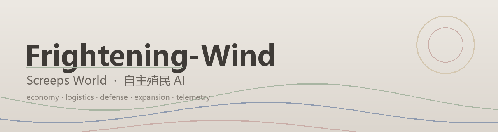

<div align="center">



# Frightening-Wind

**Screeps World 自主殖民 AI —— 从单个 spawn 到多房间经济体的完整自治实现**

[](LICENSE)
[](https://screeps.com)
[](src/)
[](#-测试)
[](#-roadmap)
[](#-贡献)

</div>

---

## 这是什么

Frightening-Wind 是一个为 [Screeps World](https://screeps.com) 编写的**全自治**殖民地 AI。它不依赖任何第三方机器人框架，从零实现了完整的生产链调度、物流网络、边防体系与跨房间扩张，并且把**所有决策依据**沉淀为可观测的遥测数据。

设计目标只有一个：**不顾一切地发育与增长**，同时保证经济不崩、领地不失。

```
矿源 → 静态矿工(独占站位) → 源侧容器 → 搬运工 → 控制器容器/storage → 升级者 → RCL
                                    ↓                                  ↓
                                 建造者 → 扩展/塔/容器            控制器进度 → GCL
                                    ↓
                              边防：巡逻兵 · 士兵 · 塔 · rampart · 侦察兵
```

---

## ✨ 特性

### 经济与物流
- **独占站位采矿**：每个矿工分配专属站位格，同矿源矿工互不抢位，彻底消除排队空转
- **地形感知定编**：按矿源周围可站格数（`min(可站位数, 2)`）决定编制，而非固定人数
- **两级远程运输**：远程矿工就地倾倒容器 + 接驳工批量回运，把 70 格往返拆成"站定 + 短途"
- **距离感知限价**：远程兵种自动降档到能效最优点（模型见 [`modeling/`](modeling/)）
- **工作状态机**：`working` 状态贯穿所有角色，杜绝"采集↔交付"抖动

### 防御与军事
- **威胁分级**：按敌人**能力**（攻击型/拆家型/无害）决定响应，不再因无害单位全区停摆
- **扇区制巡逻**：巡逻兵与士兵共用扇区编号，相邻房间同刻覆盖率 ≈ `巡逻单位数 / 4`
- **地形感知清障**：关键节点四向巡检，遇山体方向自动跳过，可走方向必须保持通畅
- **边境塔防**：塔按"来敌方向"布置在边境 8~12 格，RCL4+ 在威胁方向出口铺 rampart
- **敌区侦察**：侦察兵进入危险房间当 tick 取情报并立即撤离

### 扩张
- **远程采矿队**：预约 + 远程采集 + 护航，突破单房间 20 E/tick 的供给天花板
- **占房/开拓框架**：`claimer` + `pioneer` + 新房间引导建 spawn（GCL 达标自动触发）
- **Spawn 业务命名**：`Root`（主基地）/ `FW-<房间名>`（分基地），供调度与日志识别

### 可观测性
- `Memory.fw.snapshot`：每 5 tick 紧凑快照（RCL/能量/角色/工地/GCL/情报）
- `Memory.fw.ledger`：**能量流水账**（矿源差分算收入、进度差分算支出、未核销差额）
- `Memory.fw.spawnUsage`：spawn 利用率（验证生产能力是否成为瓶颈）
- `Memory.fw.diag` / `ct` / `errors` / `intel`：配额诊断、动作计数、异常环形缓冲、房间情报

---

## 📊 数据模型


**13 个模型、41 张图**，全部依据 [官方文档](https://docs.screeps.com/) 逐条核对后重建，
可在 `modeling/` 下用 `python run_all.py` 复现（约 6 秒）。

三条最影响决策的结论：

| 结论 | 数字 |
| --- | --- |
| **满速判据** | 平地需要 MOVE ≥ 权重（1:1），1:2 只在道路上成立 —— 往返时间比旧模型长 1.5 倍 |
| **维护税** | 参考配置 3.41 E/tick，其中 rampart 独占 3.00，是当前收入的 3 倍 |
| **塔的代价** | 3 座塔全速运转 = 30 E/tick，是当前全部收入的 26 倍，因此不能常开 |

其他值得注意的：
- source 容量分三档（中立 1500 / 已占 3000 / 中心房 4000），远程房天花板只有一半；
- 续命与重造的单位 TTL 成本**完全相同**，差别只在 spawn 占用时间；
- 采集 boost 是亏的、升级 boost 是赚的（采集受 source 再生速率封顶）；
- 结余 CPU 换成 pixel 约 **116 个/小时**，之前完全没利用。

完整的公式推导、逐图解读与行动优先级见 **[modeling/ANALYSIS.md](modeling/ANALYSIS.md)**。

---

## 🏗 架构

分层 + 门面。原先的巨石文件（`utils` 725 行、`defense` 748 行、`roles.military` 554 行、
`roles` 485 行、`economy` 483 行）已按职责拆成**一模块一职责**；对外入口用门面保留旧键名，
调用点一行未改、行为不变。完整说明见 **[docs/ARCHITECTURE.md](docs/ARCHITECTURE.md)**。

| 层级 | 模块 | 职责 |
|---|---|---|
| 入口 | `main.js` · `status.js` | 循环编排与异常隔离 · 控制台报告与遥测快照 |
| 编排 | `economy.js`（门面）· `mgr.room` · `mgr.spawn` · `mgr.roster` · `quota` · `construction` · `war` | 房间编排骨架 · 房间侧记账与诊断 · 孵化 · 人口重排 · 配额 · 建造规划 · 战争 |
| 角色 | `roles.js`（门面）· `role.harvester` `miner` `hauler` `builder` `upgrader` `remote` `reserve` `tidy` | 经济角色行为，一个角色一个文件 |
| 角色 | `roles.military.js`（门面）· `role.soldier` `patrol` `scout` `recon` `pioneer` | 军事与扩张角色 |
| 角色 | `defense.js`（门面）· `mgr.tower` · `mgr.wall` · `mgr.flee` | 防御执行：塔火控 · 工事规划 · 撤退 |
| 门面 | `utils.js` | 历史导出聚合，只转发不实现；`moveTo` / `say` 是纪律入口 |
| 动作 | `fw.nav` · `fw.store` · `fw.build` | ★ 全库唯一移动入口（意图模型）· 能量流 · 建造/维修/升级 |
| 基础 | `fw.log` · `fw.room` · `fw.geo` · `fw.body` · `fw.threat` · `fw.slot` · `fw.intel` | 日志与计数 · 房间快照 · 地形可达性 · 身体 · 威胁认知 · 采矿站位 · 房间情报 |
| 参数 | `config.js` | 全部可调参数：兵种、配额、阈值、战争与导航策略 |

**分层约束**：`main → economy → { mgr.*, quota, construction, war, roles, defense } → utils → { fw.* } → config`，
单向依赖、无循环引用；参数一律走 `config.js`。

**两条铁律**：
1. 位移只走 `utils.moveTo` / `utils.moveToRoom`——除 `fw.nav` 外出现 `creep.moveTo` / `creep.move` 即缺陷；
2. 防抖 / 防卡 / 防越界补丁只允许存在于 `fw.nav` 一处，其它地方加这类补丁一律不允许。

**回归**：harness 10 个场景（rcl1 / rcl1-worker / rcl2 / rcl3 / rcl4 / rcl5 / rcl-up / neighbor / enemy / empty）
+ `boundary.js` 边界横跳与折返断言。改动的自测命令见 [docs/ARCHITECTURE.md](docs/ARCHITECTURE.md)。

---

## 🚀 快速开始

### 1. 获取代码

```bash
git clone git@github.com:Dynesshely/Frightening-Wind.git
```

### 2. 配置同步脚本

Screeps 客户端只认**扁平目录**中的 `main.js` 及其 `require` 的模块，因此需要把 `src/*.js` 平铺复制到客户端脚本目录：

```powershell
Copy-Item tools/deploy.example.ps1 tools/deploy.ps1
# 编辑 tools/deploy.ps1，把 $dst 指向你的客户端脚本目录，例如：
#   $env:USERPROFILE\AppData\Local\Screeps\scripts\<服务器ID>\default
pwsh -File tools/deploy.ps1
```

> `tools/deploy.ps1` 含本机路径，已被 `.gitignore` 忽略，不会入库。

### 3. 观察运行状态

游戏内控制台每 25 tick 输出一段 `[FW]` 报告；更细的数据可通过只读 HTTP API 读取 `Memory.fw.*`。

---

## 🧪 测试

五套校验，一条命令跑完（在本地测试台目录下 `node all.js`）：

| 套件 | 内容 | 覆盖 |
|---|---|---|
| **语法** | 40 个模块 | 全量 `node --check` |
| **harness** | 10 场景 | RCL1 / RCL1-单工人 / RCL2 / RCL3 / RCL-升级 / RCL4 / RCL5 / **双房间** / 敌袭 / 空世界，各跑 200–800 tick，无异常、无未实现 API |
| **boundary** | 3 场景 | **边界横跳断言**：房间切换频率、边界格占比、原地抖动折返率 |
| **defense-test** | 20 用例 | 塔优先级与射程、安全模式冷却、撤退触发、工事规划、Memory 卫生 |
| **planning-test** | 7 用例 | 连通性洪水填充、封路判定、地形墙豁免、威胁分级、矿源站位 |

> **`boundary` 这一套是专门为"单位在房间边界来回穿梭"建的。** 这个缺陷前后修过四轮都没根治，
> 最后发现根因不在某处补丁，而是整层架构缺少"意图"概念：每个 tick 都重新决定去哪，谁都能推翻这个决定。
> 现在它被量化成三条断言（切换频率 / 边界占比 / 抖动折返率），改任何移动相关代码都必须过这一关。

> 另外「四邻全被扩展围死 → 判定为封路」这条用例，正是把一次线上事故（单位被建筑围死、路径互相当墙导致永久死锁）固化成回归防线。

---

## 📁 目录结构

```
.
├── src/                    # 机器人运行时代码（唯一会被同步到游戏的部分）
├── modeling/               # 数学建模（13 个模型 / 41 张图，依据官方文档重建）
│   ├── mw/params.py        # 参数唯一来源（80 个常量，与官方 Constants 核对过）
│   ├── mw/style.py         # 莫兰迪配色与绘图工具
│   ├── models/             # 每个文件一个主题
│   ├── output/             # 图表产出（含 overview.png 总览拼图）
│   ├── ANALYSIS.md         # 完整分析报告
│   └── run_all.py          # 一键复现
├── analysis/               # 早期建模（保留作历史对照，已被 modeling/ 取代）
│   ├── mining_balance.py   # 采矿编制平衡模型
│   ├── spawn_threshold.py  # Spawn 门槛模型
│   ├── *.png               # 对应图表
│   └── FINDINGS.md         # 经济分析报告
├── docs/                   # ARCHITECTURE / MODEL / OPTIMIZATION 等文档
├── docs/banner.png         # README 横幅
├── tools/                  # 同步脚本（deploy.ps1 不入库，仅保留 example）
├── .gitignore
├── LICENSE                 # MIT
└── README.md
```

---

## 🗺 Roadmap

- [x] 单房间经济闭环（采矿 → 物流 → 升级 → 建造）
- [x] 防御体系（塔防 + 巡逻 + 清障 + 威胁分级）
- [x] 遥测与能量流水账
- [x] 采矿/生产能力的量化建模
- [ ] RCL5 link 网络实战调优
- [ ] 远程采矿 2.0（远程容器 + 静态矿工 + 接驳 + 护航全链路）
- [ ] 多房间扩张（GCL 2 自动占房 → 开拓 → `FW-<房间>` spawn）
- [ ] `economy.js` 按职责物理拆分

---

## 🤝 贡献

欢迎 issue 与 PR。提交前请确保：

1. `src/` 下所有文件通过语法检查；
2. harness 场景全部 PASS；
3. 防御与规划两套断言全绿；
4. 新增参数写入 `config.js`，不要在角色里写魔法数字。

---

## 📄 License

[MIT](LICENSE) © 2026 Dynesshely

---

<div align="center">

**Star History**

[](https://star-history.com/#Dynesshely/Frightening-Wind&Date)

</div>
